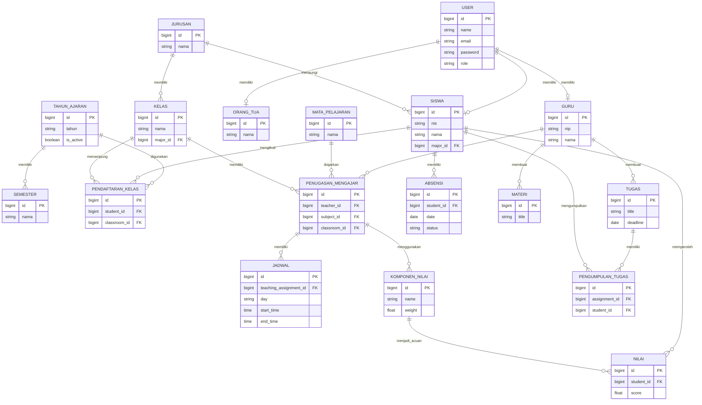

# PERANCANGAN.md
# Sistem Informasi Akademik Sekolah (SIAKAD V2)

## 1. Deskripsi Singkat Sistem

SIAKAD V2 (Sistem Informasi Akademik) merupakan aplikasi berbasis web yang dikembangkan untuk membantu sekolah dalam mengelola kegiatan administrasi dan akademik secara terintegrasi.

Sistem ini dirancang untuk mempermudah pengelolaan data siswa, guru, kelas, mata pelajaran, jadwal pelajaran, absensi, penilaian, rapor, serta aktivitas pembelajaran secara digital.

Aplikasi memiliki empat jenis hak akses pengguna, yaitu Admin, Guru, Siswa, dan Orang Tua. Setiap pengguna memiliki fitur dan akses yang disesuaikan dengan perannya masing-masing.

Pada tahap pengembangan saat ini, sistem menggunakan Laravel sebagai backend dan PostgreSQL sebagai database, sehingga data dapat dikelola melalui aplikasi dan disimpan secara terpusat.

### 1.1 Teknologi yang Digunakan

- **Backend:** PHP 8.2 dan Laravel 12.
- **Database:** PostgreSQL.
- **Frontend:** Laravel Blade.
- **CSS Framework:** Tailwind CSS melalui CDN.
- **Typography:** Google Fonts (Newsreader dan Public Sans).
- **Version Control:** Git dan GitHub.

---

## 2. Hirarki Menu (Sidebar / Navbar)

Struktur menu disusun berdasarkan hak akses masing-masing pengguna.

```text
SIAKAD V2
│
├── Dashboard
│   └── Ringkasan Informasi Akademik
│
├── Admin
│   ├── Data Master
│   │   ├── Data Siswa
│   │   ├── Data Guru
│   │   ├── Data Orang Tua / Wali
│   │   ├── Data Kelas
│   │   ├── Data Jurusan
│   │   ├── Data Mata Pelajaran
│   │   ├── Tahun Ajaran
│   │   └── Semester
│   │
│   ├── Pengelolaan Akademik
│   │   ├── Data Pendaftaran Kelas
│   │   ├── Penugasan Mengajar
│   │   ├── Jadwal Pelajaran
│   │   └── Kenaikan Kelas
│   │
│   ├── Pengelolaan Pengguna
│   │   └── Manajemen User
│   │
│   └── Laporan
│       ├── Laporan Siswa
│       ├── Laporan Guru
│       ├── Laporan Nilai
│       └── Laporan Absensi
│
├── Guru
│   ├── Jadwal Mengajar
│   ├── Absensi Siswa
│   ├── Komponen Penilaian
│   ├── Pengelolaan Nilai
│   ├── Materi Pembelajaran
│   ├── Tugas
│   ├── Pengumpulan Tugas
│   └── Laporan Akademik
│
├── Siswa
│   ├── Jadwal Pelajaran
│   ├── Nilai
│   ├── Absensi
│   ├── Materi Pembelajaran
│   ├── Daftar Tugas
│   ├── Pengumpulan Tugas
│   └── Rapor
│
├── Orang Tua
│   ├── Jadwal Pelajaran
│   ├── Nilai Siswa
│   ├── Absensi Siswa
│   ├── Materi Pembelajaran
│   └── Informasi Tugas
│
├── Pengumuman
│
└── Pengaturan Akun
    ├── Profil / Akun
    └── Ganti Password
```

**Catatan:** Menu dan hak akses mengikuti pengelompokan route serta role yang diterapkan pada aplikasi. Tidak semua menu ditampilkan kepada setiap pengguna.

---

## 3. Konsep ERD (Entity Relationship Diagram)

Database SIAKAD V2 menggunakan PostgreSQL. Struktur database terdiri dari beberapa entitas yang saling berhubungan untuk mendukung proses administrasi dan pembelajaran.

Berikut merupakan gambaran konseptual hubungan antarentitas utama:



**Catatan:** ERD di atas merupakan gambaran konseptual entitas dan relasi utama. Detail foreign key, atribut, serta kardinalitas perlu dicocokkan kembali dengan migration dan relasi model yang digunakan dalam implementasi aplikasi.

---

## 4. Rencana User Flow

### 4.1 Admin

1. Admin melakukan login.
2. Sistem mengarahkan Admin ke Dashboard.
3. Admin mengelola data master seperti siswa, guru, kelas, jurusan, dan mata pelajaran.
4. Admin mengatur tahun ajaran, semester, jadwal, dan penugasan mengajar.
5. Admin dapat memantau laporan akademik.
6. Admin mengelola akun dan hak akses pengguna.

### 4.2 Guru

1. Guru melakukan login.
2. Guru melihat jadwal mengajar.
3. Guru mengelola absensi siswa.
4. Guru mengatur komponen penilaian dan menginput nilai.
5. Guru mengunggah materi pembelajaran.
6. Guru membuat tugas dan memeriksa pengumpulan tugas siswa.

### 4.3 Siswa

1. Siswa melakukan login.
2. Siswa melihat jadwal pelajaran.
3. Siswa mengakses materi pembelajaran.
4. Siswa melihat dan mengumpulkan tugas.
5. Siswa memantau nilai dan absensi.
6. Siswa melihat rapor akademik.

### 4.4 Orang Tua

1. Orang tua melakukan login.
2. Orang tua mengakses informasi akademik siswa.
3. Orang tua memantau jadwal pelajaran.
4. Orang tua melihat nilai dan absensi siswa.
5. Orang tua mengakses informasi materi dan tugas.

---

## 5. Tema Visual UI yang Dipilih

**Tema: Modern Academic Dashboard**

SIAKAD V2 menggunakan pendekatan desain antarmuka yang modern, sederhana, dan berfokus pada kemudahan pengelolaan informasi akademik.

Konsep visual menggunakan kombinasi warna netral dan hijau sebagai warna utama untuk memberikan kesan profesional, nyaman, dan mudah dibaca.

### 5.1 Konsep Warna

- **Paper:** Warna dasar latar belakang aplikasi.
- **Board:** Warna hijau yang digunakan pada elemen utama dan navigasi.
- **Pencil:** Warna aksen untuk memberikan penekanan pada elemen tertentu.

### 5.2 Typography

- **Newsreader:** Digunakan untuk heading atau judul halaman.
- **Public Sans:** Digunakan untuk teks utama dan informasi antarmuka.

### 5.3 Alasan Pemilihan Tema

- Cocok untuk aplikasi administrasi akademik dengan banyak informasi.
- Memudahkan pengguna membedakan menu, informasi, dan tindakan.
- Menggunakan kombinasi warna yang nyaman dilihat.
- Mendukung penggunaan komponen UI yang konsisten.
- Mempermudah pengembangan tampilan pada berbagai halaman.

---

## 6. UI Wireframing & Design System

### 6.1 Konsep Layout

Antarmuka SIAKAD V2 menggunakan pendekatan dashboard dengan navigasi utama di bagian sidebar dan navbar.

Komponen layout utama:

- **Sidebar:** Navigasi menu berdasarkan hak akses pengguna.
- **Navbar:** Menampilkan informasi navigasi dan akun pengguna.
- **Main Content:** Area utama untuk menampilkan informasi dan halaman modul.
- **Breadcrumb:** Menunjukkan posisi halaman yang sedang dibuka.
- **Page Heading:** Menampilkan judul halaman.

### 6.2 Halaman Utama

Berikut merupakan cakupan halaman yang direncanakan atau dikembangkan dalam aplikasi:

- **Login** — autentikasi pengguna.
- **Dashboard** — ringkasan informasi akademik.
- **Data Siswa** — pengelolaan data siswa.
- **Data Guru** — pengelolaan data guru.
- **Data Kelas** — pengelolaan data kelas.
- **Data Jurusan** — pengelolaan data jurusan.
- **Data Mata Pelajaran** — pengelolaan mata pelajaran.
- **Tahun Ajaran dan Semester** — pengelolaan periode akademik.
- **Jadwal Pelajaran** — pengelolaan jadwal pembelajaran.
- **Absensi** — pencatatan kehadiran siswa.
- **Nilai** — pengelolaan penilaian siswa.
- **Materi Pembelajaran** — pengelolaan materi.
- **Tugas** — pengelolaan tugas dan pengumpulan.
- **Laporan** — penyajian laporan akademik.
- **Rapor** — tampilan hasil belajar siswa.
- **Pengumuman** — informasi untuk pengguna.

### 6.3 Komponen UI Utama

Komponen antarmuka yang digunakan dalam aplikasi meliputi:

- Sidebar.
- Navbar.
- Breadcrumb.
- Button.
- Input Form.
- Select / Dropdown.
- Textarea.
- Checkbox.
- Alert.
- Badge.
- Card.
- Table.
- Pagination.
- Modal / Dialog sesuai kebutuhan pengembangan.

Komponen dibuat menggunakan Laravel Blade agar struktur antarmuka dapat digunakan kembali pada berbagai halaman.

### 6.4 Implementasi Frontend

Frontend dikembangkan menggunakan Blade Template dan Tailwind CSS melalui CDN.

Pendekatan ini digunakan agar proses pengembangan antarmuka dapat dilakukan tanpa konfigurasi build frontend yang kompleks pada tahap MVP.

---

## 7. Struktur Pengembangan Sistem

Pengembangan SIAKAD V2 menggunakan pendekatan Laravel dengan pembagian tanggung jawab sebagai berikut:

- **Models:** Mengelola representasi data dan relasi database.
- **Controllers:** Menangani proses request dan logika aplikasi.
- **Middleware:** Mengatur autentikasi dan pembatasan hak akses.
- **Migrations:** Mengelola struktur tabel database.
- **Seeders:** Menyediakan data awal untuk pengujian.
- **Routes:** Mengatur endpoint dan alur navigasi aplikasi.
- **Blade Views:** Menampilkan antarmuka pengguna.

Pembagian struktur tersebut bertujuan menjaga kode aplikasi tetap terorganisasi, mudah dipelihara, dan dapat dikembangkan sesuai kebutuhan.

---

## 8. Status Pengembangan

Tahapan pengembangan SIAKAD V2 meliputi:

- [x] Inisialisasi project Laravel 12.
- [x] Konfigurasi database PostgreSQL.
- [x] Pembuatan migration database.
- [x] Pembuatan model dan relasi.
- [x] Pembuatan seeder data awal.
- [x] Implementasi autentikasi pengguna.
- [x] Implementasi middleware hak akses.
- [x] Implementasi route aplikasi.
- [x] Integrasi controller dari project MVP.
- [x] Integrasi Blade Views.
- [x] Implementasi komponen layout dan UI.
- [ ] Pengujian seluruh fitur berdasarkan role.
- [ ] Penyempurnaan tampilan responsif.
- [ ] Pengujian keamanan aplikasi.
- [ ] Persiapan deployment.

**Catatan:** Checklist di atas merupakan catatan progres pengembangan. Status setiap tahapan dapat diperbarui sesuai hasil implementasi dan pengujian aplikasi.

---

## 9. Repository

**Nama Project:** SIAKAD V2

**Developer:** Rakan Dhiya

**GitHub:** [RakanDhiya](https://github.com/RakanDhiya)

**Repository:** [SIAKAD V2](https://github.com/RakanDhiya/SIAKADv2)

---

*Dokumentasi perancangan dan pengembangan Sistem Informasi Akademik Sekolah (SIAKAD V2).* 